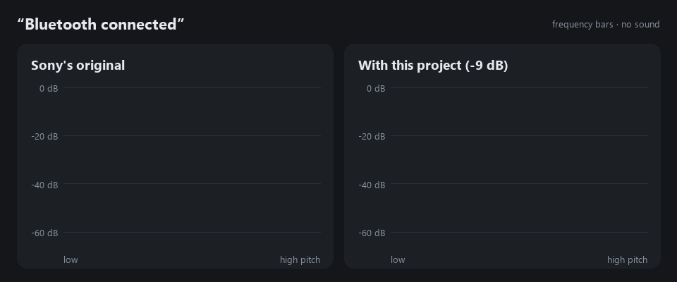
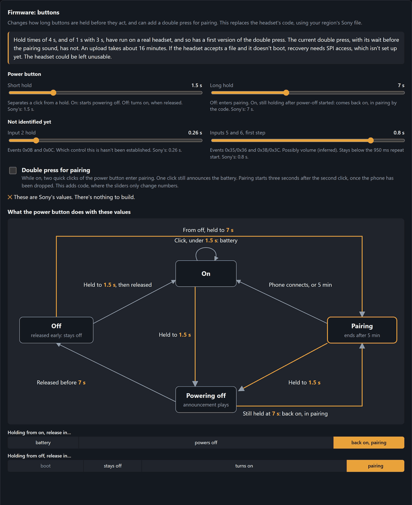

# WH-1000XM3 tweaks

Small fixes for the Sony WH-1000XM3 that Sony's app doesn't offer, from a page in your browser.

| Annoyance | Fix | Worked on my headset |
|---|---|---|
| Voice announcements and beeps are far too loud | A quieter copy of Sony's sounds (e.g. −9 dB) | ✅ |
| Pairing needs a 7 s hold of the power button | A shorter hold (e.g. 4 s) | ✅ |
| No quick way into pairing when already on | A double press of the power button | ✅ first version, latest one emulated only |
| Sony's app needed just to see the headset's state | Battery, firmware, settings, without the app | ✅ |

<picture>
  <source media="(prefers-color-scheme: light)" srcset="docs/images/announcement-quieter-light.gif">
  
</picture>

<picture>
  <source media="(prefers-color-scheme: light)" srcset="docs/images/ui-buttons-light.gif">
  
</picture>

## ⚠️ Before you use it

- **Vibe coded:** almost all of it was written by an AI assistant (Claude Code) and not every line was reviewed. Don't trust it blindly.
- **Tested on one headset:** the changes above worked on mine (firmware 4.5.2). That's not a guarantee for yours.
- **It can brick your headphones:** a bad firmware upload has no easy recovery. Use it at your own risk.
- **Not affiliated with Sony.** No Sony firmware, sounds or keys are included.

## Try it

You need a Windows PC with Bluetooth and [uv](https://docs.astral.sh/uv/). Pair the headset with the PC, then:

```sh
git clone https://github.com/ArnaudSaison/wh-1000xm3-tweaks.git
cd wh-1000xm3-tweaks
uv run flasher/app.py
```

Downloading Sony's original files needs Sony's key, which isn't included: it's published in [lzghzr/MDR_Proxy](https://github.com/lzghzr/MDR_Proxy) (`mdr.ts`). Set it as `XM3_INFOXML_KEYS`, at your own risk ([how](flasher/README.md#sonys-download-key)).

More: [the page, step by step](flasher/README.md) · [how the headset works](docs/protocol/README.md) · [code map](AGENTS.md) · [MIT license](LICENSE)
